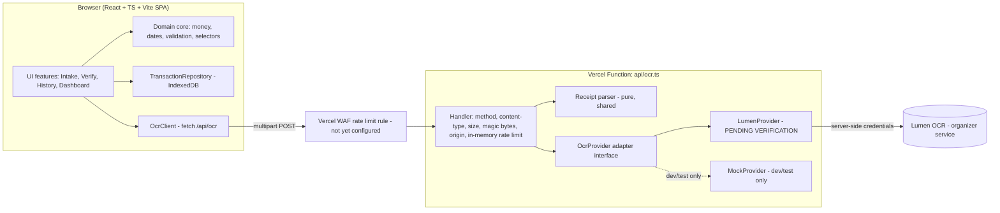
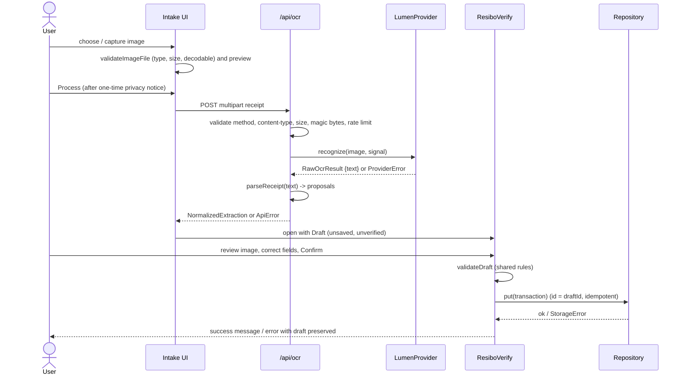
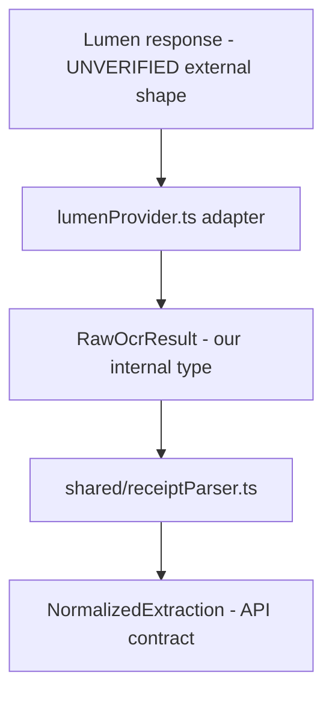
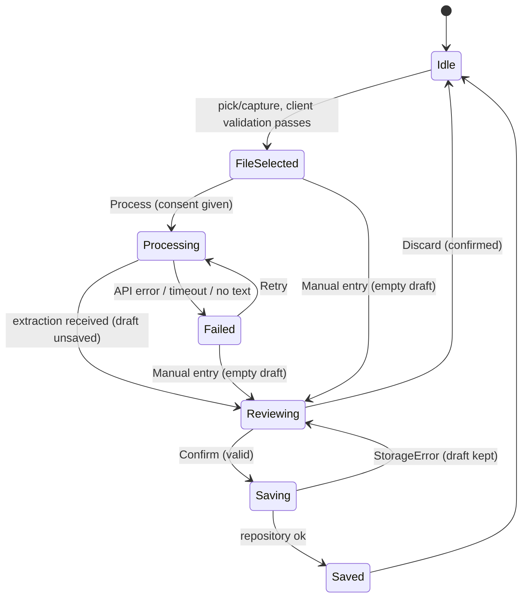

# Design Document

**Status: Draft — pending team review.** This design has not been approved by BELLEN, CLAVITE or the organizers. Requirements approval is also not assumed. Nothing in this document authorizes implementation.

## Overview

ResiboWise PH is a single Vite + React + TypeScript web application plus one server-side function (`/api/ocr`) that forwards receipt images to the organizers' Lumen OCR service. Transactions live only in the user's browser (IndexedDB). There are no accounts, no hosted database, no extra services.

Core flow: **Receipt upload → Lumen OCR → ResiboVerify → Confirm and save → Expense history → Monthly dashboard.**

This design is written for two developers in an overnight hackathon, so it favours the smallest structure that satisfies the approved requirements. It is split into a **Core MVP** (Requirements 1–14, 23, 24) and **Optional enhancements** (Requirements 15–22). No core module imports an optional module.

### Status of the Lumen integration: PENDING VERIFICATION


The Lumen API contract is unverified (Requirements Open Item 1). This design does **not** state any Lumen endpoint, authentication header, SDK, model ID, request format, response field, size limit or rate limit. It defines only:

- our own provider-independent `OcrProvider` interface (an adapter boundary), and
- the checklist of facts that must be confirmed from official organizer documentation (Section 5.6).

Everything outside `server/ocr/lumenProvider.ts` is written to work with a provider that returns **plain recognized text only**, the weakest assumption allowed by the requirements.

### Conflict and risk review against approved requirements

No approved requirement is architecturally impossible. The following tensions are flagged. None changes a requirement; each needs a team decision or is already an Open Item.

| # | Requirement | Tension | Design response |
|---|---|---|---|
| C1 | 14.5 (rate limit effective across serverless instances) vs. AGENTS.md "no additional services" | An in-memory counter does not work across serverless instances. A shared counter would normally need Redis/KV, which is an extra service. | Primary control: a **Vercel WAF rate-limiting rule** on `POST /api/ocr`. Vercel documents WAF rate limiting as a platform capability, subject to plan limits and project configuration; it is a hosting-platform feature, not a service we add. **The rule has not been configured or tested** (Section 8.2; Open Item 10). Secondary: best-effort in-memory limiter in the function. If it is unavailable, adding a shared store needs explicit team approval; the design does not assume it. |
| C2 | 2.6 (reject files above Maximum_Image_Size) vs. Vercel's request body limit | Vercel documents a 4.5 MB request body limit for Functions. Phone photos are often larger, so many real photos would be rejected. | `MAX_IMAGE_BYTES` is a configured value and the effective limit is the stricter of config, Lumen and platform (24.2). Requirement 2.6 is implemented as written (reject with a clear message). Client-side downscaling before the size check would improve usability but changes the meaning of 2.6; it is **not in the MVP** and is recorded as Proposed Change PC-1 (Section 5.7) for team approval. It is NOT applied. Oversized and invalid files get specific user messages (Section 5.7). |
| C3 | 7.5 (confirm discard on leaving ResiboVerify) | Browsers do not allow custom text in the `beforeunload` dialog. | In-app navigation is guarded with a custom confirmation dialog. Tab close or reload uses the browser's generic prompt. Documented limitation, not a violation. |
| C4 | 8.7 / 8.5 (local storage limits) | Browsers may evict site data under storage pressure. | Request persistent storage best-effort, show the required notice, handle write errors. Data loss on clearing browser data cannot be prevented, only communicated. |
| C5 | 3.7 (processing timeout) vs. function max duration | `OCR_TIMEOUT_MS` must be lower than the function's maximum duration, which depends on plan and settings. | Timeout is configured below the function limit; actual limits to be verified (Open Item 7). |
| C6 | 1.4 (no mocks in submitted build) | A mock provider is useful for parallel development. | Mock provider is for local development and automated tests only. The provider factory refuses it in every Vercel deployment (production and public preview) and unless an explicit local-only flag is set (Section 5.2). |

## Architecture

### System context



### Sequence: receipt to saved transaction



### Key architectural decisions

- **One repository, one function.** Static SPA plus `api/ocr.ts`. Shared TypeScript in `shared/` is imported by both client and function, giving one definition of types, limits, money, dates, validation and parsing.
- **Parsing runs in the OCR proxy** (Requirement 3.2/3.3 assign Normalized_Extraction production to the OCR_Proxy). The parser is a pure function in `shared/`, so it is unit and property testable without Lumen.
- **Local-first data.** The server never stores receipts or text (14.7). All persistence is IndexedDB in the browser.
- **Same-origin API.** The SPA and `/api/ocr` share an origin, so no CORS is needed.

### Repository layout (proposed)

```
api/
  ocr.ts                    # thin Vercel entry; delegates to server/ocr/handler
server/ocr/
  handler.ts                # request pipeline
  validateUpload.ts         # type/size/magic-byte checks (uses shared/config)
  provider.ts               # OcrProvider interface + factory
  lumenProvider.ts          # PENDING VERIFICATION adapter
  mockProvider.ts           # dev/test only
  rateLimit.ts              # best-effort in-memory limiter
  errors.ts                 # ApiError mapping, safe messages
shared/
  config.ts                 # all limits and formats (single location, Req 24.1)
  types.ts                  # shared contracts
  money.ts                  # parseAmount, formatPeso, sums
  dates.ts                  # Manila today, month keys, display format
  validation.ts             # validateDraft
  receiptParser.ts          # parseReceipt(text) -> proposals
src/
  app/                      # shell, routing, navigation, toasts
  features/intake/          # upload, preview, privacy notice, OCR call
  features/verify/          # ResiboVerify (also used for edit)
  features/history/         # list, search, edit, delete
  features/dashboard/       # monthly totals
  storage/                  # TransactionRepository (IndexedDB)
  components/ui/            # selected shadcn/ui components
```

## Components and Interfaces

All components stay small. Features talk to each other only through the shared contracts in Section 11.2.

### 2.1 Component responsibilities

| Component | Responsibility | Requirements |
|---|---|---|
| `IntakePanel` | File picker (`<input type="file" accept=… capture>`), camera capture where available, image preview (object URL), client validation, privacy notice gate, Process button (disabled while in flight), manual-entry link. | 2.1–2.7, 3.1, 3.8, 14.9 |
| `OcrClient` | `processReceipt(file, signal): Promise<NormalizedExtraction>`. Posts multipart to `/api/ocr`, maps `ApiError` to typed errors, enforces client abort at `OCR_CLIENT_TIMEOUT_MS`. | 3.1, 3.6, 3.7 |
| `ProcessingState` | Loading indicator with text ("Reading receipt…"), cancel, and error panels with Retry / Reselect / Manual entry actions. | 3.5–3.7, 13.1, 13.3 |
| `ResiboVerify` | Side-by-side (≥768 px) or stacked image + form. Fields: merchant, date, total. Shows "needs your input" markers, total candidate picker, inline validation errors, Confirm button. Holds the draft and dirty state. Reused by the edit flow. | 4.2, 5.1–5.6, 7.1–7.5, 9.5, 12.3 |
| `validateDraft` (pure) | The only validation function: used by OCR drafts, manual drafts, and edits. Returns field-level error codes mapped to messages. | 6.1–6.8 |
| `TransactionRepository` | `list()`, `get(id)`, `put(tx)`, `delete(id)`; typed `StorageError`. | 8.x |
| `HistoryList` | Sorted list, search box, empty and no-results states, edit and delete actions with delete confirmation. | 9.x |
| `Dashboard` | Month selector (defaults to current Manila month), recorded-expense total, count, "recorded expenses only" label, empty state. Pure selectors over the transaction list. | 10.x, 11.x |
| `AppShell` | Mobile-first navigation: bottom tab bar (<768 px) with Add / History / Dashboard; top or side nav (≥768 px). Router with unsaved-changes guard. Toast region for success/error messages. | 12.x, 13.x, 7.5 |
| `StorageNotice` | Persistent short notice that data is stored only in this browser on this device and may be lost if browser data is cleared. | 8.7 |

State management: a single React context holding `transactions`, `status` (`loading | ready | recovery | error`) and mutation functions that call the repository then update state. No Redux or query library. Draft state is local to `ResiboVerify` (React state, `useReducer`).

Draft lifetime: the draft and the receipt `File` exist only in memory. A page refresh discards them (the generic `beforeunload` prompt applies while the draft is dirty).

### 2.2 Navigation and error/empty/success states

- Routes: `/` (Add receipt), `/verify` (draft), `/history`, `/history/:id/edit`, `/dashboard`. The `vercel.json` rewrite excludes `/api/*`.
- Leaving `/verify` or edit with a dirty draft opens a discard-confirmation dialog (router blocker) (7.5).
- Every list/dashboard has an empty state with a call-to-action (9.9, 10.7, 13.4).
- Success and error feedback uses a toast plus inline text; state is never conveyed by color alone (13.5).
- Error text is selected from one table keyed by error code (Section 4.3), so every error states what failed and the next step (13.3).

### 2.3 UI library usage

Tailwind for styling; shadcn/ui only for `Button`, `Input`, `Label`, `Dialog`/`AlertDialog`, `Toast`/`Sonner`, `Select`; Lucide React for icons. No chart library in the core.

## Data Models

### 3.1 Storage mechanism: IndexedDB (recommended)

| Option | Pros | Cons |
|---|---|---|
| localStorage | Trivial API, synchronous | ~5 MB limit, string-only, whole-collection rewrite on each change (non-atomic, risks corruption on interrupted write), cannot hold images |
| **IndexedDB** | Per-record atomic transactions, larger quota, structured data, blobs for optional receipt images, async | More code, needs a test shim (`fake-indexeddb`) |

**Decision: IndexedDB**, wrapped by a thin `TransactionRepository` using the `idb` helper library (pin exact version at install time). Reasons: per-record `put`/`delete` give safe update/delete without rewriting the whole data set; optional image retention (Req 19) needs no storage migration; quota errors are catchable per write. The repository interface hides the mechanism, so a localStorage fallback could be substituted without touching features. Small UI preferences (privacy-notice acknowledged flag) may use localStorage.

### 3.2 Transaction model

```ts
// shared/types.ts
export type IsoDate = string;        // "YYYY-MM-DD", validated calendar date
export type Centavos = number;       // positive safe integer

export interface Transaction {
  id: string;                  // crypto.randomUUID(), created when the draft is created
  schemaVersion: 1;
  merchant: string;            // trimmed, 1..MERCHANT_MAX_LENGTH chars
  purchaseDate: IsoDate;       // Manila calendar date as printed on receipt / entered
  amountCentavos: Centavos;    // 1..MAX_AMOUNT_CENTAVOS
  createdAt: string;           // ISO 8601 UTC instant
  updatedAt: string;           // ISO 8601 UTC instant
  category?: string;           // OPTIONAL enhancement (Req 15); core ignores it
}
```

Rules:

- IndexedDB database `resibowise`, version 1; object store `transactions` (keyPath `id`) with index `byPurchaseDate`. Optional enhancement stores (`receiptImages`, `settings`) are added in later schema versions only if built.
- The draft's `id` is generated when the draft is created and becomes the Transaction `id`. Saving uses `put`, so repeated confirm actions write the same record (7.4).
- Receipt image retention is optional (Req 19): when built, images are stored in a separate `receiptImages` store keyed by Transaction id. Core code never reads it.
- Each stored record is validated with a schema (hand-written type guard or a small schema library) when loaded.

### 3.3 Monetary precision

- Amounts are positive safe integers of centavos. No floating-point arithmetic touches money.
- `parseAmount(input: string): Result<Centavos, AmountError>` parses with a strict regex on the string (allowing optional `₱`/`PHP`, whitespace and thousands commas), splits on `.` and builds `whole * 100 + fraction` with integer math. Errors: `EMPTY`, `NOT_A_NUMBER`, `NEGATIVE_OR_ZERO`, `TOO_MANY_DECIMALS`, `TOO_LARGE`.
- `MAX_AMOUNT_CENTAVOS` is a design cap of ₱999,999,999.99 (`99_999_999_999`). It keeps sums of realistic data far below `Number.MAX_SAFE_INTEGER`. This cap is a design choice; it is not in the requirements.
- `formatPeso(c)` returns `₱1,234.50` using integer division and manual grouping (no `toFixed` on a float).

### 3.4 Dates and Asia/Manila

- Purchase dates are stored as `IsoDate` strings. A purchase date is a calendar date, so no time zone conversion is applied to it.
- "Today" is computed from an injected `now: Date` with `new Intl.DateTimeFormat('en-US', { timeZone: 'Asia/Manila', year: 'numeric', month: '2-digit', day: '2-digit' }).formatToParts(now)`. The `year`, `month` and `day` values are read **independently by part `type`** and assembled into `YYYY-MM-DD` by our own code (zero-padded). The design never relies on a locale-formatted string having a `YYYY-MM-DD` layout (no `en-CA` string assumption, no parsing of `format()` output). The locale argument only selects digit style; part extraction makes the result locale-layout independent. If any of the three parts is missing, the function throws a programming error rather than guessing. All functions take `now` as a parameter so tests control it.
- Asia/Manila has no daylight-saving transitions, so a fixed UTC+8 offset is a valid independent **test oracle** for `formatToParts` output (Property 4); production code uses the `Intl` time zone, not the fixed offset.
- Month key = `purchaseDate.slice(0, 7)` (`YYYY-MM`). Month membership never uses `Date` parsing of the purchase date.
- Display format: `DD MMMM YYYY` (`05 March 2025`) using a fixed English month-name table (not locale-dependent) (24.3).
- `createdAt`/`updatedAt` are UTC ISO instants for bookkeeping only; they do not affect summaries.

### 3.5 Persistence, safe update/delete and failure handling

- Load: `list()` opens a read transaction, validates each record, returns `{ valid: Transaction[], invalid: unknown[] }`.
- Invalid records are **not deleted or overwritten**. The UI enters `recovery` status with a message and the choice to keep them untouched or (explicit confirmation) clear them (8.6).
- Update: read-modify-write inside one `readwrite` IndexedDB transaction so concurrent tabs cannot interleave a partial write. Delete: single `delete(id)`.
- Write failure (`QuotaExceededError`, `InvalidStateError`, DB blocked/unavailable) is converted to `StorageError` with `kind: 'quota' | 'unavailable' | 'unknown'`. The UI keeps the draft on screen, shows an error, and does not show the success message (8.5).
- If IndexedDB cannot be opened at all, the app shows a blocking-but-informative error for saving, while manual viewing of empty state still renders.
- Other tabs: the context re-reads the store on `visibilitychange` to pick up changes from another tab (simple; no BroadcastChannel).
- On first successful save the app calls `navigator.storage.persist()` best-effort; failure is ignored.

### 3.6 Selectors (pure, shared)

```ts
sortTransactions(txs): Transaction[]               // purchaseDate desc, then createdAt desc, then id
searchTransactions(txs, term): Transaction[]       // case-insensitive "contains" on merchant; empty term -> all
monthKey(date: IsoDate): string
summarizeMonth(txs, monthKey): { totalCentavos: number; count: number }
currentMonthKey(now: Date): string                 // Manila
```

The Dashboard derives its numbers from `transactions` at render time (memoized), so totals are always consistent with the saved data (11.1).

## Internal API Contracts

These are **our** contracts, independent of Lumen's.

### 4.1 `POST /api/ocr`

Request: `multipart/form-data` with one file field `receipt`. No other fields. Same-origin only.

Success `200`:

```ts
interface OcrSuccessResponse {
  ok: true;
  requestId: string;
  provider: 'lumen' | 'mock';                // 'mock' is only possible in local dev/tests; UI shows a visible MOCK banner
  extraction: NormalizedExtraction;
}

interface NormalizedExtraction {
  text: string;                              // recognized text; display-only, plain text (14.10)
  merchant: ProposedField<string>;
  purchaseDate: ProposedField<IsoDate>;
  payableTotal: ProposedTotal;
  parserNotes: ParserNote[];                 // e.g. "DATE_AMBIGUOUS_DD_MM"
}

type ProposedField<T> =
  | { status: 'proposed'; value: T; evidence: string }   // evidence = the receipt line it came from
  | { status: 'missing' };

type ProposedTotal =
  | { status: 'proposed'; centavos: Centavos; evidence: string; candidates: AmountCandidate[] }
  | { status: 'missing'; candidates: AmountCandidate[] };   // user must type or pick

interface AmountCandidate {
  centavos: Centavos;
  line: string;                              // original text line
  label: 'total' | 'amount_due' | 'subtotal' | 'tax' | 'cash' | 'change' | 'discount' | 'unlabelled';
}
```

Notes: "ambiguous" is represented as `status: 'missing'` plus non-empty `candidates` (Requirement 3.3 defines only proposed or missing). The response does not claim that any value was "reported by Lumen" (3.4).

Error `4xx/5xx`:

```ts
interface OcrErrorResponse {
  ok: false;
  requestId: string;
  error: {
    code: OcrErrorCode;
    message: string;               // safe, user-facing, no internals
    retryAfterSeconds?: number;    // RATE_LIMITED only
  };
}
```

### 4.2 Error codes

| Code | HTTP | Meaning | UI actions |
|---|---|---|---|
| `METHOD_NOT_ALLOWED` | 405 | Not POST | none (developer error) |
| `UNSUPPORTED_MEDIA_TYPE` | 415 | Not multipart, or part not a supported image type / magic bytes mismatch | Reselect, shows supported types |
| `FILE_TOO_LARGE` | 413 | Over `MAX_IMAGE_BYTES` | Reselect, shows max size |
| `BAD_REQUEST` | 400 | Missing `receipt` part, extra parts | Reselect |
| `FORBIDDEN_ORIGIN` | 403 | Cross-site request | none |
| `RATE_LIMITED` | 429 | Over request limit | Try again later |
| `NO_TEXT` | 422 | Provider returned no readable text | Reselect or manual entry |
| `UPSTREAM_TIMEOUT` | 504 | Provider did not answer within `OCR_TIMEOUT_MS` | Retry or manual entry |
| `UPSTREAM_ERROR` | 502 | Provider unavailable or returned an error | Retry or manual entry |
| `UPSTREAM_UNINTERPRETABLE` | 502 | Provider response could not be mapped | Retry or manual entry |
| `SERVER_MISCONFIGURED` | 500 | Credentials/config missing or mock in production | Manual entry |
| `OCR_DISABLED` | 503 | Kill switch `OCR_DISABLED=true` | Manual entry |

Client-only failures (network error, client abort timeout, undecodable image) are raised by `OcrClient`/`IntakePanel` using the same message table.

### 4.3 Validation errors (client/domain)

`validateDraft(input: DraftInput, now: Date): ValidationResult`

```ts
interface DraftInput { merchant: string; purchaseDate: string; amount: string; }
type FieldError =
  | 'MERCHANT_REQUIRED'
  | 'DATE_REQUIRED' | 'DATE_INVALID' | 'DATE_IN_FUTURE'
  | 'AMOUNT_REQUIRED' | 'AMOUNT_INVALID' | 'AMOUNT_NOT_POSITIVE'
  | 'AMOUNT_TOO_MANY_DECIMALS' | 'AMOUNT_TOO_LARGE';
type ValidationResult =
  | { ok: true; value: { merchant: string; purchaseDate: IsoDate; amountCentavos: Centavos } }
  | { ok: false; errors: Partial<Record<'merchant' | 'purchaseDate' | 'amount', FieldError>> };
```

Mapping to requirements: `AMOUNT_REQUIRED`→6.1, `AMOUNT_INVALID`→6.2, `AMOUNT_NOT_POSITIVE`→6.3, `AMOUNT_TOO_MANY_DECIMALS`→6.4, `DATE_REQUIRED`/`DATE_INVALID`→6.5, `DATE_IN_FUTURE`→6.6, `MERCHANT_REQUIRED`→6.7. The Confirm button is disabled while `ok: false` (6.1–6.7).

### 4.4 Draft contract

`extractionToDraft(extraction | null): DraftState` — a pure function. Missing fields become empty strings with `needsInput: true`; proposed fields are prefilled with `status: 'proposed'` (never `verified`). A draft becomes `verified` only on Confirm (5.3, 5.4, 5.5).

## OCR Integration Boundary

### 5.1 Layering



The Lumen response shape never leaves `lumenProvider.ts`.

### 5.2 Provider-independent interface

```ts
// server/ocr/provider.ts
export interface OcrInput {
  bytes: Uint8Array;
  mimeType: SupportedImageType;
  fileName?: never;                 // file names are not forwarded or logged
}

export interface RawOcrResult {
  text: string;                     // concatenated recognized text; may be empty
  // Optional extras are added ONLY after the Lumen contract is verified:
  // lines?: { text: string; box?: unknown }[];
}

export type ProviderErrorKind = 'timeout' | 'unavailable' | 'rejected' | 'uninterpretable' | 'misconfigured';

export class ProviderError extends Error {
  constructor(public kind: ProviderErrorKind, public safeDetail?: string) { super(kind); }
}

export interface OcrProvider {
  recognize(input: OcrInput, opts: { signal: AbortSignal }): Promise<RawOcrResult>;
}

export function createProvider(env: ServerEnv): OcrProvider;  // lumen | mock
```

Rules:

- `createProvider` returns `LumenProvider` by default. The `MockProvider` is allowed **only if all** of these hold: `OCR_PROVIDER=mock`, the explicit local-only flag `LOCAL_MOCK_OCR=true` is set, `NODE_ENV !== 'production'`, and the process is **not a Vercel deployment**, i.e. `VERCEL_ENV` is unset or `development` (a Vercel deployment sets `VERCEL_ENV` to `production` or `preview`; both are refused, so public preview URLs shown to judges can never use the mock). Otherwise the factory throws `ProviderError('misconfigured')`. Exactly how `VERCEL_ENV` is populated under `vercel dev` must be verified when implementing; if it is ambiguous, the safe choice is to refuse the mock. Automated tests do not use env flags: they inject `MockProvider` directly into the handler.
- Mock output is never presented as Lumen output: responses carry `provider: 'mock'` and the UI shows a visible "MOCK OCR — not Lumen" banner. A mock success must never appear in the submitted app.
- **Fail safe when Lumen is not configured.** If required Lumen configuration is missing or incomplete, `LumenProvider` throws `ProviderError('misconfigured')`, the API returns `SERVER_MISCONFIGURED` (500), and the UI shows "Receipt reading is unavailable right now" with the manual-entry action. There is no fallback to the mock and no fabricated extraction. The error never names which variable is missing.
- `LumenProvider` is a stub whose body is written only after verification (5.6). Until then it must throw `ProviderError('misconfigured')`, not fabricate output.
- Provider upstream error bodies are never copied into `ProviderError.safeDetail` (14.8).
- If verified Lumen output turns out to include structure (positions, fields, confidence), only `RawOcrResult` and the parser may be extended. Requirement 21.4 forbids relying on confidence unless the verified contract provides it.

### 5.3 Handler pipeline (`server/ocr/handler.ts`)

1. Reject methods other than `POST` (405).
2. If `OCR_DISABLED` → 503.
3. Same-origin check on `Origin` / `Sec-Fetch-Site` (cheap, weak abuse barrier); reject cross-site (403).
4. Check `Content-Type` is `multipart/form-data` (415) and `Content-Length` (if present) ≤ `MAX_IMAGE_BYTES + MULTIPART_OVERHEAD_BYTES` (413) before reading the body.
5. Best-effort in-memory rate limit keyed by client IP (Section 7.3).
6. Parse form data; require exactly one `receipt` part; check actual byte length ≤ `MAX_IMAGE_BYTES`; check declared MIME ∈ `SUPPORTED_IMAGE_TYPES` and that the **magic bytes** match the declared type (14.3).
7. Create `AbortController` with `OCR_TIMEOUT_MS`; call `provider.recognize`.
8. Map `ProviderError` to API error codes. Empty/whitespace-only `text` → `NO_TEXT` (3.5).
9. `parseReceipt(text)`; return `NormalizedExtraction`.
10. Log only a safe record: `{ requestId, status, errorCode?, durationMs, sizeBytes }`. Never log bytes, text, headers, or upstream bodies (14.7).

Image bytes and text live only in function memory for the duration of the request.

### 5.4 Limits and configuration (`shared/config.ts`)

```ts
export const CONFIG = {
  SUPPORTED_IMAGE_TYPES: [/* UNSET until verified, see Open Items 3 */] as const,
  MAX_IMAGE_BYTES: /* UNSET until verified */ 0,
  OCR_TIMEOUT_MS: /* UNSET until decided, Open Item 11 */ 0,
  OCR_CLIENT_TIMEOUT_MS: /* OCR_TIMEOUT_MS + margin */ 0,
  OCR_RATE_LIMIT: { requests: /* TBD */ 0, windowSeconds: /* TBD */ 0 },
  MERCHANT_MAX_LENGTH: 120,
  MAX_AMOUNT_CENTAVOS: 99_999_999_999,
  MULTIPART_OVERHEAD_BYTES: 16_384,
} as const;

// Verified external limits are recorded here after confirmation:
export const VERIFIED_LIMITS: { lumenMaxBytes?: number; lumenTypes?: readonly string[]; platformMaxBodyBytes?: number } = {};
export const effectiveMaxBytes = (): number => minDefined(CONFIG.MAX_IMAGE_BYTES, VERIFIED_LIMITS.lumenMaxBytes, VERIFIED_LIMITS.platformMaxBodyBytes);
```

`effectiveMaxBytes` and the effective type list (intersection) implement 24.2 ("stricter of the two"). Values marked UNSET are deliberately not guessed. Common image types (e.g. JPEG, PNG) are the likely candidates, but the list is filled in only after verification. `CONFIG` holds non-secret values only and is imported by both client and function (24.1).

### 5.5 Deployment-related limits: documented capabilities vs. items to verify

**(a) Documented Vercel platform capabilities (relied on by this design):**

- TypeScript Vercel Functions placed under `/api` (e.g. `api/ocr.ts`).
- Standard Web `Request`/`Response` handler style, which `server/ocr/handler.ts` uses so it can also be called directly from tests.
- A **4.5 MB request body limit** for Vercel Functions. This is a documented fact, not an assumption; it is recorded in `VERIFIED_LIMITS.platformMaxBodyBytes` (4.5 MB = 4,718,592 bytes if the platform defines MB as MiB; the team confirms the exact byte value from the current Vercel documentation when implementing, and sets the config to the stricter reading).
- Vercel WAF rate-limiting rules exist as a platform feature, subject to plan limits and project configuration.

**(b) Still to be configured and verified by the team (nothing below is claimed as done):**

- Function maximum duration for the team's plan and the `maxDuration` value in `vercel.json`.
- Whether WAF rate limiting is available on the team's plan, the rule itself, its limit values, and a test that it triggers (Open Item 10). Not configured, not tested.
- Function memory sufficient for the largest allowed image.
- Whether Lumen can be called from a Vercel-hosted function (credentials, network restrictions).
- Local dev behaviour (Deployment Design, local development).

Rules that follow:
- `OCR_TIMEOUT_MS` must be lower than `maxDuration`, leaving time for parsing and response.
- The uploaded image is held in memory; keep `MAX_IMAGE_BYTES` small enough for the function's memory allocation.

### 5.6 What must be confirmed from official organizer documentation (PENDING VERIFICATION)

Nothing below is assumed anywhere in this design.

1. Access method and endpoint (HTTP API, SDK, or other) and base URL.
2. Authentication scheme, credential format and how credentials are issued to the team.
3. Whether credentials may be used from a Vercel-hosted server function (network/IP restrictions).
4. Request format for submitting an image (multipart, base64, URL, or other) and any required parameters (language, options).
5. Response structure: plain text only, text with positions, structured fields, confidence, alternatives.
6. Error format, status codes and retry guidance.
7. Supported image formats and maximum file size/dimensions.
8. Rate limits and quotas per key.
9. Typical and maximum latency (to set `OCR_TIMEOUT_MS`).
10. Data-handling terms (retention/logging of submitted images).
11. Whether usage must be attributed or flagged in the demo.

Until items 1–5 are verified, `LumenProvider` remains a stub that throws `misconfigured`, and local development uses `MockProvider` (local only, Section 5.2). The submitted build requires the real adapter (Req 1.1, 1.4).

**Current blocker.** The organizers have provided an API key and secret, but the external API contract is **not established**: no verified endpoint, authentication header scheme, request format or response structure is available to the team. `lumenProvider.ts` stays pending official documentation. This design does not invent endpoints, auth headers, response fields or features, and credentials are not read or placed in any file by this work.

**Minimum information required to implement and test the real integration (checklist):**

- [ ] Official organizer document (or URL) that describes the Lumen OCR API, with its version/date.
- [ ] Endpoint URL(s) and HTTP method for submitting an image.
- [ ] How the issued key and secret are used (header names, signing, token exchange, or other), and whether a server-side call from Vercel is permitted.
- [ ] Request format for the image (multipart, base64 JSON, URL, other) and any required parameters.
- [ ] A sample successful response and which field holds the recognized text.
- [ ] Error response format, status codes, and retry guidance.
- [ ] Supported image formats, maximum file size and dimensions.
- [ ] Rate limits/quotas and expected latency.
- [ ] Data-handling terms for submitted images.
- [ ] A way to run one real request (test receipt) that the team is permitted to make.

Items 1–6 of this checklist are required before `lumenProvider.ts` is written; the rest tune limits and messages.

### 5.7 Phone photos above the upload limit

**Problem.** The effective limit is the minimum of `MAX_IMAGE_BYTES`, the Lumen limit (unknown), and what fits in the Vercel 4.5 MB request body after multipart overhead (`MULTIPART_OVERHEAD_BYTES`). Base64 encoding inflates data by about one third, so the browser→function hop uses **binary multipart** (never base64), which keeps the effective file limit close to 4.5 MB minus overhead. Whether the function→Lumen hop needs base64 depends on the unverified Lumen contract and may lower the limit further (included in `effectiveMaxBytes` once known). Many modern phone photos exceed this size.

**MVP behaviour (compliant with Requirement 2.6 as written).** Files above the effective limit are rejected before upload, and the user gets actionable guidance instead of a bare error. The MVP does not resize, compress or re-encode the selected file.

| Situation | Where checked | Message shown (text; paired with a retry/reselect action) |
|---|---|---|
| Unsupported type | Client and server | "This file type isn't supported. Please choose a photo in one of these formats: {list}." Also offers "Enter manually". |
| File too large | Client (before upload) and server | "This photo is {size} MB. The maximum is {max} MB. Try a lower camera resolution or a smaller-size setting, or take the photo again closer to the receipt, then select it again. You can also enter the receipt manually." |
| Not a readable image (type OK, decode fails) | Client; server magic-byte mismatch returns `UNSUPPORTED_MEDIA_TYPE` | "We couldn't read this file as an image. Please choose a different photo or enter the receipt manually." |
| Empty (0-byte) file | Client and server | "This file is empty. Please choose a different photo." |

Messages always state what failed and the next step (13.3), and never rely on color alone (13.5). `{max}` is read from `effectiveMaxBytes()`.

**Proposed Change PC-1 — NOT APPLIED, for team approval.** Add optional client-side downscaling/compression (canvas re-encode to a supported type) when a selected image exceeds the effective limit, so the *processed derivative* is submitted instead of rejecting. This changes how Requirement 2.6 ("reject the file") is interpreted, so it needs explicit team approval and a requirement clarification before it is built. If approved, the preview and ResiboVerify would still show the image that was actually sent, and the size check would apply to the derivative. Alternatives that need a new service (for example direct-to-storage upload) are not proposed because AGENTS.md forbids adding services without an approved requirement.

## Receipt Verification Flow (ResiboVerify)

### 6.1 Principles

- Every extracted value is a **proposal**. Nothing is `verified` until the user confirms.
- The design assumes Lumen may return only text. It never assumes structured merchant/date/total from Lumen.
- Missing and ambiguous values are preserved and shown as such; the app never silently chooses.

### 6.2 Draft state machine



Processing disables the Process button (3.8). The draft id is created on entering `Reviewing`. OCR completion never writes to storage (7.2).

### 6.3 Minimal parser (`shared/receiptParser.ts`)

`parseReceipt(text: string): Omit<NormalizedExtraction, 'text'>` is a pure, total function (never throws, any string input). Heuristics are deliberately small and conservative. Exact rules for Philippine receipts are Open Item 9 and will be tuned with sample receipts.

**Amounts.** Extract candidates from each line with a regex that accepts optional `₱`, `PHP`, `P`, thousands commas and exactly two decimals. Classify each line by keywords (case-insensitive):

| Label | Example keywords |
|---|---|
| `total` | `TOTAL`, `GRAND TOTAL`, `TOTAL SALES` (not preceded by `SUB`) |
| `amount_due` | `AMOUNT DUE`, `TOTAL DUE`, `AMOUNT PAYABLE`, `BALANCE DUE` |
| `subtotal` | `SUBTOTAL`, `SUB-TOTAL`, `SUB TOTAL` |
| `tax` | `VAT`, `VATABLE`, `VAT-EXEMPT`, `TAX`, `ZERO-RATED` |
| `cash` | `CASH`, `TENDER`, `PAYMENT`, `RECEIVED` |
| `change` | `CHANGE` |
| `discount` | `DISCOUNT`, `SENIOR`, `PWD`, `SC/PWD` |
| `unlabelled` | no keyword |

**Payable total rule.** Let `P` = the set of **distinct** amounts on lines labelled `total` or `amount_due`.

- `|P| = 1` → `status: 'proposed'`.
- `|P| ≥ 2` (for example, a total and a different amount due after a Senior/PWD discount) → `missing`, all candidates listed (4.2).
- `|P| = 0` → `missing`; candidates are still listed with their labels so the user can pick (4.2).
- Amounts labelled `subtotal`, `tax`, `cash`, `change`, `discount` and `unlabelled` are **never** proposed (4.3). They appear only as candidates with their label shown, so the user can see why they are not chosen.

**Date rule.** Recognise ISO `YYYY-MM-DD`, month-name forms (`05 Mar 2025`, `March 5, 2025`) and numeric forms `A/B/YYYY`, `A-B-YYYY`, `A.B.YYYY`.

- Month-name and ISO forms are unambiguous → propose if it is a real calendar date.
- Numeric `A/B/YYYY`: if one part is >12 it is unambiguous; if both parts are ≤12 and differ, the day/month order is **ambiguous** → `missing` with note `DATE_AMBIGUOUS_DD_MM`. If both are equal the result is unambiguous.
- Two-digit years are not guessed; those dates are `missing`.
- Multiple distinct valid dates in the text → `missing` (note `DATE_MULTIPLE`).
- A date in the future is still proposed; validation rejects it at save (6.6).

**Merchant rule.** Among the first 6 non-empty lines, take the first line with at least 3 letters that does not match date, phone, amount, or boilerplate keywords (`RECEIPT`, `INVOICE`, `TIN`, `VAT REG`, `OFFICIAL`, `ADDRESS`, `TEL`). Propose it as editable text. This is the weakest heuristic; the UI treats it like any other proposal.

All proposals carry an `evidence` line so the user can see where they came from. Receipt text is untrusted and rendered as plain text (14.10).

### 6.4 Confirmation rules

- Confirm is enabled only when `validateDraft` returns `ok` (6.x).
- Confirm triggers a single `repository.put`. The button is disabled while saving, and the idempotent id also prevents duplicate records (7.4).
- If the total is `missing`, the user must type an amount or choose a candidate; choosing a candidate fills the input but still requires Confirm.
- Warnings or notes (for example `DATE_AMBIGUOUS_DD_MM`) are informational and shown next to the field; they are based only on parser-detected conditions, not Lumen confidence (21.4).

## Error Handling

### 7.1 Secrets and configuration

- Credentials exist only as Vercel environment variables read inside `server/ocr/*` through `process.env`. No `VITE_` prefix is ever used for secrets (anything `VITE_`-prefixed is bundled to the client).
- `.env*` files are in `.gitignore`; `.env.example` lists names only.
- The app never logs, echoes or returns credentials; errors are mapped through a whitelist (`errors.ts`) so raw upstream bodies, stack traces and paths are never sent to the client (14.8).
- A CI/manual smoke check greps the built `dist/` for credential variable names and values.

### 7.2 Request validation

Server validation (never trusting the client) as in the Section 5.3 pipeline: method, content-type, declared and actual size, MIME allow-list and magic-byte check, exactly one file part. The client runs the same `validateImageFile` function from `shared/` for fast feedback (2.4–2.6) and additionally checks decodability with `createImageBitmap`/`Image` (2.7).

### 7.3 Abuse protection (Requirement 14.5, 14.6; see Conflict C1)

1. **Primary:** a Vercel WAF rate-limiting rule on `POST /api/ocr` (a documented platform capability, subject to plan limits and project configuration). Limit values are decided by the team (Open Item 10). **Status: not configured and not tested.** If configured, it works across all instances; until then the in-memory limiter and guards below are the only protection.
2. **Secondary:** best-effort in-memory sliding-window limiter in the function keyed by client IP from the platform-supplied forwarded header. Per-instance only, so it is not relied on alone. Returns `RATE_LIMITED` with `retryAfterSeconds` (14.6).
3. **Cheap guards:** same-origin check, strict size cap, single-file multipart, kill switch `OCR_DISABLED`.
4. **Quota protection:** because there are no accounts, anyone with the URL can call the endpoint. The WAF rule (once configured and tested) and the kill switch are the protection for the organizers' quota; until then only the in-memory limiter and cheap guards apply. This residual risk is accepted for the hackathon and stated openly.

### 7.4 Privacy

- No server persistence of images or text (14.7). The function is stateless.
- A one-time privacy notice (acknowledged flag in localStorage) tells the user the image goes to our server and to Lumen and may contain sensitive information (14.9). Process is disabled until acknowledged.
- Logs contain only the safe record in Section 5.3.
- Browser-side: the receipt `File` and its object URL are revoked when the draft is discarded or saved (unless the optional retention is built).

### 7.5 Content safety (14.10)

- All receipt-derived and user-entered text is rendered through React text nodes. `dangerouslySetInnerHTML` is banned via ESLint (`react/no-danger`).
- `vercel.json` sets security headers: `Content-Security-Policy` (default-src 'self'; img-src 'self' blob: data:), `X-Content-Type-Options: nosniff`, `Referrer-Policy: no-referrer`, `Permissions-Policy` allowing camera for self.

### 7.6 Production error handling

- Function: a top-level try/catch maps any unexpected exception to `UPSTREAM_ERROR` or `SERVER_MISCONFIGURED` with a generic message and a `requestId`.
- Client: every `OcrErrorCode` and client-side failure has an entry in one message table with a next-step action (13.3). Unknown codes fall back to a generic message with Retry and Manual entry.
- Storage errors (Section 3.5) keep the draft and never show success.
- React error boundary at the shell level shows a recoverable error screen that does not discard IndexedDB data.

## Deployment Design

- **Hosting:** Vercel, subject to Lumen compatibility (Requirement 23.4; Open Items 5 and 7). `api/ocr.ts` is a TypeScript Vercel Function using the documented standard Web `Request`/`Response` handler style (Section 5.5(a)). The Node.js runtime is assumed; the team confirms the runtime setting and the exact export shape against the current Vercel documentation while implementing.
- **Local development:**
  - *Primary:* `vercel dev` runs the Vite frontend and the `/api` functions together on one origin. It needs the Vercel CLI and a linked project. Environment values come from a gitignored `.env.local`, never from committed files. **To verify by the team:** that `vercel dev` starts the Vite app and `/api/ocr` correctly on the team's machines, and which `VERCEL_ENV` value it exposes (relevant to the mock guard in Section 5.2).
  - *Documented alternative:* run `vite` with `server.proxy` forwarding `/api` to a small local Node script that imports `server/ocr/handler.ts` and adapts Node requests to the Web `Request`/`Response` handler. Whether this script needs a dev dependency (for running TypeScript) is a team decision; no dependency is added by this design.
  - *Tests* call the handler directly with a Web `Request`, so they need neither approach.
  - Plain `vite` alone serves only the SPA; `/api/ocr` would not exist. The README must state the chosen approach.
- **`vercel.json` (to be written and verified at implementation):** SPA rewrite for non-`/api` paths, `functions` entry with `maxDuration` (value limited by the team's plan, Section 5.5(b)) and optionally `memory` for `api/ocr.ts`, security headers.

### 8.2 Deployment risk status

| Item | Status |
|---|---|
| 4.5 MB request body limit, `/api` TS functions, Web handler style | Documented platform facts, designed around |
| Function `maxDuration` for the team's plan | To verify |
| WAF rate-limiting rule (availability, limits, rule, test) | **Not configured, not tested** |
| Lumen callable from Vercel | Unverified |
| `vercel dev` behaviour with Vite + `/api` | To verify |
| Mock cannot run on production/preview | Designed (Section 5.2); to verify by a deployed-preview check |
- **Fallback:** if Lumen cannot be called from Vercel (IP/network restriction, duration, or payload limits), the OCR_Proxy is moved to another server-side host. This is an architectural fallback and would require a team decision, because AGENTS.md prohibits adding services without approval.

Environment variable **names only** (final set depends on the verified Lumen authentication scheme):

| Name | Scope | Purpose |
|---|---|---|
| `LUMEN_API_KEY` *(provisional)* | server | Lumen credential; the organizers issued a key and secret, but name and usage depend on the unverified contract |
| `LUMEN_API_SECRET` *(provisional)* | server | Issued secret, if the verified scheme uses one |
| `LUMEN_BASE_URL` *(provisional)* | server | Lumen service base URL, if the contract uses one |
| `OCR_PROVIDER` | server | `lumen` (default) or `mock` (local only) |
| `LOCAL_MOCK_OCR` | local only | Must be `true` for the mock to be allowed; never set on Vercel |
| `OCR_DISABLED` | server | Kill switch |
| `VERCEL_ENV` | platform | Read by the mock guard: mock refused unless unset or `development` |

Non-secret limits (types, sizes, timeouts, rate limit values) live in `shared/config.ts`, not in environment variables, so client and server cannot diverge. Any additional variable required by the verified Lumen contract is added to `.env.example` as a name only.

## Correctness Properties

*A property is a characteristic or behavior that should hold true across all valid executions of a system-essentially, a formal statement about what the system should do. Properties serve as the bridge between human-readable specifications and machine-verifiable correctness guarantees.*

**Property reflection.** The prework produced about 35 testable criteria. Redundancies were merged: 6.1–6.4 and 6.7–6.8 are covered by one validation oracle (Property 3) plus the amount parser (Property 2); 10.2/10.3/10.4/10.5/11.5 collapse into the month-summary oracle (Property 5); 8.1/8.2/8.8 into the repository round trip (Property 9); 4.1–4.3 into two parser properties; 2.4–2.6/14.3 into the upload validation property. UI-only criteria are covered by example tests (Section 9).

**Prioritization for a two-person overnight hackathon.** All 19 properties remain documented, and the underlying requirements are unchanged. Only the *mandatory automated scope* is reduced: properties are split into a Mandatory tier (must exist and pass before submission) and an Optional tier (additional coverage, written only if time remains). Optional properties' behaviours are still required of the system; they are just verified by the example tests and the manual checklist in Section 9 unless the property test is added.

| Tier | Properties | Covers |
|---|---|---|
| **Mandatory** | 1, 2 | PHP money parsing and formatting |
| **Mandatory** | 3 | Required-field validation |
| **Mandatory** | 4 | Asia/Manila date handling |
| **Mandatory** | 5, 6 | Monthly totals and edit/delete deltas |
| **Mandatory** | 9 | Transaction persistence round trip (save/edit/delete storage) |
| **Mandatory** | 12, 13, 14 | Conservative receipt parsing |
| **Mandatory** | 18 | Safe OCR API failure handling (no leaks) |
| Optional | 7, 8, 10, 11, 15, 16, 17, 19 | History ordering, search, confirm idempotence, corrupt-data quarantine, draft mapping, upload-validation oracle, method gate, in-memory limiter |

Optional-tier behaviours that are still verified in the mandatory scope by example tests: confirm saves exactly one record (7.4), invalid stored data is not overwritten (8.6), upload type/size boundaries (2.4–2.6, 14.3), and method/content-type rejection (14.4).

### Property 1: Peso amount round trip

*For any* integer `c` in `[1, MAX_AMOUNT_CENTAVOS]`, `parseAmount(formatPlain(c))` returns `c`, and `formatPeso(c)` matches `^₱\d{1,3}(,\d{3})*\.\d{2}$` and `parseAmount(formatPeso(c))` returns `c`.

**Validates: Requirements 6.2, 8.3, 24.5**

### Property 2: Amount parser accepts exactly valid PHP amounts

*For any* string, `parseAmount` succeeds if and only if it denotes a number with at most two decimal places, strictly greater than zero and not above the cap; strings with three or more decimals, zero, negative values, empty or non-numeric text are rejected with the corresponding error code and never produce a value.

**Validates: Requirements 6.1, 6.2, 6.3, 6.4**

### Property 3: Draft validation matches the field rules

*For any* draft input and any `now`, `validateDraft` returns `ok` if and only if the merchant is not blank after trimming, the amount is valid (Property 2), and the date is a real calendar date not later than the Manila date of `now`; every failing field has its own error and the result does not depend on whether the draft came from OCR, manual entry or edit.

**Validates: Requirements 6.1, 6.2, 6.3, 6.4, 6.5, 6.6, 6.7, 6.8**

### Property 4: Manila date and month boundaries

*For any* UTC instant `t`, `manilaToday(t)` equals the calendar date of `t + 8 hours` (UTC), `currentMonthKey(t)` is its `YYYY-MM` prefix, and for any valid ISO date `d`, `displayDate(d)` has the form `DD MonthName YYYY` with the correct month name and the same day/year digits.

**Validates: Requirements 6.6, 10.1, 24.3, 24.4**

### Property 5: Monthly summary is the exact integer sum

*For any* list of transactions and any month key, `summarizeMonth` returns a total equal to the exact integer sum (checked against a `BigInt` oracle) of `amountCentavos` of those whose `purchaseDate` starts with that key, a count equal to the number of such transactions, the same result for any permutation of the list, and `{0, 0}` when none match. Every transaction belongs to exactly one month, so the sum of all month totals equals the sum of all amounts.

**Validates: Requirements 10.2, 10.3, 10.4, 10.5, 10.7, 11.5**

### Property 6: Edits and deletes change totals by exact deltas

*For any* list of transactions and any transaction `t` in it: changing only its amount changes its month's total by exactly `new − old`; changing its date to another month decreases the old month by `t.amount` and increases the new month by `t.amount`; deleting it decreases its month by `t.amount` and removes it from the count; all other months are unchanged; and deleting or moving the last transaction of a month yields `{0, 0}`.

**Validates: Requirements 9.8, 11.2, 11.3, 11.4, 11.6**

### Property 7: History ordering

*For any* list of transactions, `sortTransactions` returns a permutation of the list in which `purchaseDate` is non-increasing, with ties ordered deterministically.

**Validates: Requirements 9.1**

### Property 8: Search filters by merchant, case-insensitively

*For any* list of transactions and search term, `searchTransactions` returns exactly the transactions whose merchant, lowercased, contains the lowercased term; an empty term returns the whole list.

**Validates: Requirements 9.2, 9.3**

### Property 9: Repository round trip and reload

*For any* valid Transaction (and any set of them), writing to the repository and reading back (including after closing and reopening the database) yields equivalent transactions with exact centavo values.

**Validates: Requirements 8.1, 8.2, 8.3, 8.8**

### Property 10: Confirm is idempotent

*For any* valid draft and any number `k ≥ 1` of confirm actions on it, the repository contains exactly one transaction with the draft's id and its content equals the draft's validated value.

**Validates: Requirements 7.4**

### Property 11: Corrupt stored data is quarantined, not destroyed

*For any* set of stored records mixing valid and arbitrary invalid JSON values, `list()` returns exactly the valid ones, reports the invalid ones for recovery, and leaves all stored records (valid and invalid) present until the user explicitly confirms clearing.

**Validates: Requirements 8.6**

### Property 12: Parser is total and only proposes well-formed values

*For any* string (including random and adversarial text), `parseReceipt` does not throw, every field has status `proposed` or `missing`, every proposed amount is a positive safe integer of centavos, and every proposed date is a real ISO calendar date.

**Validates: Requirements 3.2, 3.3**

### Property 13: Payable total is proposed only when unambiguous and labelled

*For any* generated receipt text, `payableTotal` is `proposed` if and only if the lines labelled total/amount-due carry exactly one distinct amount, and then the proposed value equals that amount; when they carry two or more distinct amounts the status is `missing` and all of them appear among the candidates; amounts that appear only on subtotal, tax, cash, change, discount or unlabelled lines are never proposed.

**Validates: Requirements 4.1, 4.2, 4.3**

### Property 14: Ambiguous numeric dates are never guessed

*For any* numeric date `A/B/YYYY` with `A ≠ B` and both `A, B ≤ 12`, the parser does not propose a purchase date and emits the ambiguity note; *for any* date written with a month name or in ISO form, the parser proposes the matching ISO date.

**Validates: Requirements 3.3, 4.4, 5.3**

### Property 15: Draft mapping never marks proposals as verified

*For any* `NormalizedExtraction` (or none), `extractionToDraft` yields empty, `needsInput` fields exactly where the extraction is `missing`, prefilled proposals elsewhere, and no field with status `verified`.

**Validates: Requirements 5.3, 5.4, 5.5**

### Property 16: Upload validation accepts exactly valid files, with stricter limits winning

*For any* file description (declared MIME type, size, leading bytes) and any configured and verified limits, `validateUpload` accepts if and only if the type is in the effective supported list, the leading bytes match that type, and the size is at most the minimum of the defined limits; the client and server entry points give identical results.

**Validates: Requirements 2.4, 2.5, 2.6, 14.3, 24.2**

### Property 17: Method and content-type gate

*For any* HTTP method other than POST, or any content type other than multipart form data, the handler responds with 405/415 without calling the provider.

**Validates: Requirements 14.4**

### Property 18: Error responses never leak secrets or upstream bodies

*For any* provider failure carrying arbitrary text (including the configured credential value, file paths and stack traces), the API error body contains none of that text; only the whitelisted code, message and request id.

**Validates: Requirements 14.2, 14.8**

### Property 19: In-memory limiter never exceeds its window limit

*For any* sequence of request timestamps for one client key, the number of accepted requests inside any window of `windowSeconds` is at most `requests`, and rejected requests receive `RATE_LIMITED` with a positive `retryAfterSeconds`.

**Validates: Requirements 14.6**

## Testing Strategy

### 9.1 Approach

Dual approach, prioritized for the hackathon: the **mandatory** tier (Section 9.1 scope list and the Correctness Properties tier table) comes first; everything else is additional coverage. **Property-based tests** cover the pure logic layer (money, dates, validation, selectors, parser, repository round trip) and **example/integration/manual tests** cover UI, the external Lumen call and deployment. PBT is not used for UI rendering, layout, the Lumen call, or the Vercel WAF.

- Test runner: Vitest. Property-based library: `fast-check` (do not hand-roll). Component tests: React Testing Library + `user-event`. IndexedDB: `fake-indexeddb`. Optional end-to-end/responsive checks: Playwright, or manual device checks if time is short. Confirm the scripts that exist in `package.json` before running.
- **Mandatory scope** (must pass before submission): (1) PHP money parsing/calculation properties; (2) Manila date handling; (3) required-field validation; (4) conservative receipt parsing; (5) save/edit/delete and persistence; (6) safe OCR API failure handling; (7) **one real Lumen OCR integration test**, run manually with real credentials once the contract is verified, with the actual result recorded (not mockable for the submission claim); (8) a **manual end-to-end test on the deployed app** (checklist in 9.3). Everything else in the test map is **additional coverage**, done as time permits.
- Each implemented property is a **single** property-based test tagged `// Feature: resibowise-ph, Property N: <property text>`. Mandatory properties run **50 iterations or fewer by default**, set through one configurable constant (for example a shared `numRuns` read from a test-only setting, with a quick local value and a higher value available for a final run). IndexedDB-backed properties (Property 9) may use a lower value such as 25 because `fake-indexeddb` is slower. Optional properties use the same configurable default. The earlier 100-iteration minimum is dropped for the hackathon.
- Time is injected (`now: Date`) everywhere so tests never depend on the wall clock.

### 9.2 Test map to acceptance criteria

| Area | Requirements | Test type | Notes |
|---|---|---|---|
| Upload validation (client) | 2.4, 2.5, 2.6 | Example tests (mandatory): type/size boundary at exactly max bytes, message text from Section 5.7; Property 16 optional | Boundary at exactly max bytes |
| Upload decodable check | 2.7 | Edge-case example; manual | Needs real browser decode |
| File select, preview, camera | 2.1, 2.2, 2.3 | Component example; camera is manual on a phone | |
| OCR integration (real Lumen) | 1.1, 1.2, 3.1 | **Mandatory: one real Lumen integration test**, run manually with real credentials once the contract is verified; record actual results. Blocked until the Lumen contract is documented | Not mockable for the submission claim |
| OCR failure modes | 1.3, 3.5, 3.6, 3.7 | Example tests with `MockProvider`: throw, hang (fake timers), empty text, malformed | |
| No mock in production | 1.4 | Example tests (mandatory): factory refuses the mock when `VERCEL_ENV` is `production` or `preview`, when `LOCAL_MOCK_OCR` is unset, or when `NODE_ENV=production`; missing Lumen config returns `SERVER_MISCONFIGURED` with no extraction; manual check on a deployed preview that the mock is refused | Never simulate Lumen success |
| Processing UI states | 3.8, 13.1 | Component example | |
| Missing/ambiguous fields | 3.3, 4.1–4.4, 5.3 | Properties 12, 13, 14, 15 + fixtures of anonymized Philippine receipt texts (VAT, SC/PWD discount) | Fixtures collected for Open Item 9 |
| Corrections / ResiboVerify | 5.1–5.6, 7.1–7.3, 7.5 | Component examples; no write before Confirm | |
| Validation | 6.1–6.8 | Properties 2, 3 | |
| Save idempotence | 7.4 | Property 10 | |
| Persistence | 8.1–8.4, 8.8 | Properties 9, 11 + examples | |
| Storage failure | 8.5 | Example: repository stub throws quota error; draft kept, no success | |
| Storage notice | 8.7 | Component example | |
| History / search / edit / delete | 9.1–9.9 | Properties 7, 8, 6 + component examples | |
| Dashboard | 10.1–10.7, 11.1–11.6 | Properties 4, 5, 6 + reactivity example | |
| Responsive/mobile | 12.1–12.3 | Playwright viewport checks at 360, 768, 1920 px, or manual | Not PBT |
| Touch/keyboard | 12.4 | Keyboard component tests + manual phone walkthrough | |
| States and messaging | 13.1–13.5 | Table-driven test: every error code has message + action | |
| Security | 14.1, 14.2, 14.4, 14.8, 14.10 | Properties 17, 18; bundle grep smoke test; render test with `<script>` text | |
| Rate limiting | 14.5, 14.6 | Property 19 (optional, best-effort limiter); WAF rule **not configured or tested yet**, manual verification required once configured | 14.5 cannot be proved by unit tests |
| Privacy notice | 14.7, 14.9 | Console-spy example; component example | |
| Configuration | 24.1, 24.2 | Smoke test + Property 16 | |
| Production deployment | 1.1, 14.1, 23.4 | **Manual**: deployed URL, real Lumen receipt end to end, mobile phone, check logs contain no receipt data | Record outcome honestly |

### 9.3 Core workflow verification checklist (manual, on the deployed URL)

1. Upload a real receipt on a phone; preview shows.
2. Privacy notice appears once; Process runs; loading text is visible.
3. ResiboVerify shows image beside/above the form; missing fields marked; total not auto-chosen when ambiguous.
4. Correct fields; invalid values block Confirm with messages.
5. Confirm; success message; refresh; transaction persists.
6. Search, edit (date moves months), delete with confirmation.
7. Dashboard totals update and are labelled recorded expenses.
8. Force failures: oversize file, wrong type, offline, simulated provider timeout (via config), kill switch.

## Technical Decisions and Trade-offs

| Decision | Alternatives | Rationale / trade-off |
|---|---|---|
| IndexedDB behind a repository | localStorage | Atomic per-record writes, bigger quota, blobs for optional images; costs a little more code and a test shim. |
| Parser in the OCR function, shared as pure module | Parse in browser | Matches Req 3.2/3.3 (proxy produces Normalized_Extraction); the module is pure, so it remains easily testable. Heuristics are server-deployed, so tuning requires redeploy. |
| Text-only provider assumption | Assume structured fields | Safe against the unverified contract; may need to extend `RawOcrResult` later. `lumenProvider.ts` stays pending official documentation. |
| Conservative parser (prefer `missing` over a guess) | Aggressive heuristics | Satisfies "never silently guess"; more manual typing for users. |
| Integer centavos, hand-written parse/format | Decimal library | Zero dependency, small surface, property-testable. |
| Date as ISO string, month by string prefix | `Date` objects | Avoids time-zone drift for purchase dates. "Today" uses `Intl.DateTimeFormat.formatToParts` with `Asia/Manila`, not locale string layout. |
| Limits in `shared/config.ts`, not env | Environment variables | One location for client and server (24.1); changing a limit requires redeploy. |
| Vercel WAF rate limit + in-memory best effort | Redis/KV counter | Avoids an extra service (C1); WAF availability depends on plan and configuration, and the rule is not yet configured or tested. |
| React context + reducer | Redux, TanStack Query | Local data only; smallest sufficient state tool. |
| Reject oversize files (as written in 2.6) | Auto-downscale | Respects approved requirement; usability cost noted in C2. Client-side compression is Proposed Change PC-1, not applied. |
| Mock provider, local-only behind an explicit flag, refused on all Vercel deployments | No mock | Allows parallel work without credentials; guarded by factory (C6); cannot appear in production or preview. |
| Reduced mandatory PBT scope (11 properties, 50 or fewer iterations, configurable) | All 19 properties at 100+ iterations | Fits a two-person overnight schedule; remaining properties kept as optional coverage. |

### 10.1 Core MVP vs. optional enhancements

| Core MVP (build first) | Optional (only after core works; never a dependency of core) |
|---|---|
| Intake + validation + preview (R2) | Category (R15): `category?` field already tolerated by the model; UI and search extension only |
| OCR proxy + adapter + parser (R1, R3, R4, R14) | Monthly budget (R16): new `settings` store in a later schema version |
| ResiboVerify + validation + confirm (R5–R7) | Duplicate warning (R17): pure function over `list()` result |
| Repository + history/search/edit/delete (R8, R9) | Category chart (R18): needs R15; no chart library in core |
| Dashboard + consistency (R10, R11) | Image retention (R19): separate `receiptImages` store; core never reads it |
| Responsive, states, a11y baseline (R12, R13) | Zoom (R20), ambiguity warnings (R21 — beyond parser notes), offline notice (R22) |
| Config + formats (R24) | |

Rule: optional features add files and store versions but never alter core function signatures. The core `Transaction` type contains only one optional field (`category`), which core code treats as opaque.

## Open Integration Dependencies and Team Collaboration

### 11.1 Open dependencies (from requirements, with design impact)

| # | Item | Blocks |
|---|---|---|
| 1 | Lumen API contract (endpoint, auth, request/response, errors) | `lumenProvider.ts`, real end-to-end test |
| 2 | Lumen output content (text only vs structured) | Parser input assumptions |
| 3 | Supported image types and size limits | `SUPPORTED_IMAGE_TYPES`, `MAX_IMAGE_BYTES` |
| 4 | Lumen rate limits/quotas | `OCR_RATE_LIMIT` values |
| 5 | Credential delivery and Vercel compatibility | Deployment |
| 6 | Data handling terms | Privacy notice wording |
| 7 | Vercel function duration for the chosen plan (the 4.5 MB body limit is documented and designed around) | `maxDuration`, `OCR_TIMEOUT_MS`, effective max bytes |
| 9 | Payable-total rules from sample Philippine receipts | Parser tuning and fixtures |
| 10 | Rate-limit mechanism and values (Vercel WAF availability on the plan; rule not yet configured or tested) | 14.5 compliance |
| 11 | Processing timeout value | `OCR_TIMEOUT_MS` |
| 12–14 | Optional enhancement decisions | Scope beyond core |

Items 1, 3, 5 and 7 are blocking for the "real Lumen integration is mandatory" requirement and should be resolved first. The Lumen API contract (items 1–3) is the single largest blocker: keys and a secret were issued, but no endpoint, authentication usage or response format is documented to the team (Section 5.6 checklist).

### 11.5 Decisions needing team approval (none are assumed approved)

| # | Decision | Default in this draft |
|---|---|---|
| D1 | Approve this reduced mandatory testing scope (11 properties, 50 or fewer configurable iterations, one real Lumen test, one manual E2E) | Proposed as written |
| D2 | PC-1: client-side image downscaling/compression, which changes the interpretation of Requirement 2.6 | Not applied; MVP rejects oversize files with guidance |
| D3 | Local dev approach: `vercel dev` vs Vite proxy + local Node script (and any dev dependency it needs) | `vercel dev` primary, proxy documented as alternative |
| D4 | WAF rate-limit values and whether the plan supports it | Not configured |
| D5 | Mock guard rules (Section 5.2) and `LOCAL_MOCK_OCR` flag name | Proposed as written |
| D6 | Approval of requirements, this design, and tasks (AGENTS.md approval sequence) | **Pending** — no approval assumed |

### 11.2 Minimum shared contracts before parallel work

These files should be written and agreed first (small, mostly types and signatures), after which modules can be developed independently:

1. `shared/types.ts` — `Transaction`, `DraftInput`, `ValidationResult`, `NormalizedExtraction`, `ProposedField`, `ProposedTotal`, `AmountCandidate`, `OcrSuccessResponse`, `OcrErrorResponse`, `OcrErrorCode`.
2. `shared/config.ts` — `CONFIG` shape with UNSET placeholders and `effectiveMaxBytes`.
3. Function signatures (with stub implementations): `parseAmount`, `formatPeso`, `manilaToday`, `currentMonthKey`, `displayDate`, `validateDraft`, `parseReceipt`, `summarizeMonth`, `sortTransactions`, `searchTransactions`, `extractionToDraft`.
4. `TransactionRepository` interface and `StorageError` type.
5. `OcrClient.processReceipt` signature and `OcrProvider` interface.
6. `MockProvider` plus 2–3 fixture receipt texts and a canned `NormalizedExtraction`, so UI work does not wait for Lumen.

### 11.3 Module boundaries (suggested; ownership between BELLEN and CLAVITE is not assumed)

Modules touch each other only via the contracts above, so any module can be taken by either developer. A natural split into independent tracks:

| Track | Modules | Depends on |
|---|---|---|
| **A. OCR server** | `api/ocr.ts`, `server/ocr/*` (handler, validateUpload, provider, lumenProvider, rateLimit, errors), `vercel.json`, env docs | contracts 1, 2, 5 |
| **B. Parsing** | `shared/receiptParser.ts` + receipt text fixtures + parser property tests | contract 1 |
| **C. Domain core** | `shared/money.ts`, `shared/dates.ts`, `shared/validation.ts`, selectors + property tests | contracts 1, 2 |
| **D. Storage** | `src/storage/*` (IndexedDB repository, schema guard, recovery) | contracts 1, 4 |
| **E. Intake + Verify UI** | `features/intake`, `features/verify`, `OcrClient` | contracts 1, 3, 5, 6 (uses stubs) |
| **F. History + Dashboard + Shell** | `features/history`, `features/dashboard`, `app/` | contracts 1, 3, 4 |

Integration points that need joint review: `shared/types.ts`, `shared/config.ts`, `TransactionRepository`, and the `NormalizedExtraction` contract. Changes to these require both developers' agreement (AGENTS.md: coordinate changes to shared contracts).

### 11.4 Suggested integration order (for task planning later)

1. Shared contracts and mock provider.
2. In parallel: Tracks A+B and C+D.
3. UI tracks E and F against stubs/mocks.
4. Swap in the real `LumenProvider` once verified; run the manual end-to-end checklist on the deployed URL.
5. Optional enhancements only if the core checklist passes.
